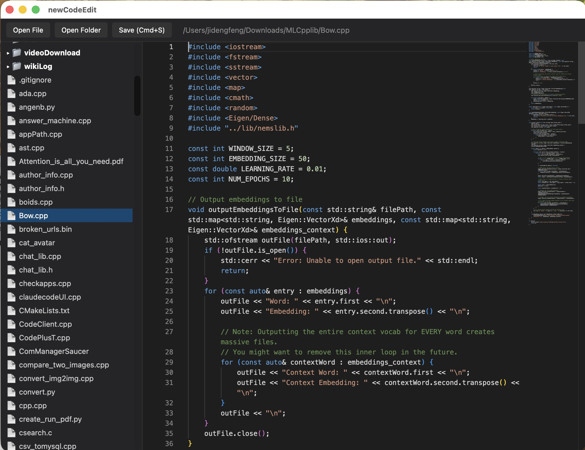

# newCodeEdit 🚀

`newCodeEdit` is a lightweight, blazing-fast native desktop code editor built from scratch with **C++23** and **Saucer**, powered by the industry-standard **Monaco Editor** (the core engine behind VS Code). 

Designed for developers who love first-principles engineering, zero-bloat native binaries, and strict system safety.

---

## ✨ Key Features

* **High-Performance C++23 Backend:** Zero heavy framework overhead; utilizes modern C++23 features like `std::expected` for bulletproof error handling.
* **Robust Atomic File Saves:** Protects against data corruption during crashes by writing to a hidden temporary file in the same directory before executing an atomic `rename()` with full disk synchronization (`F_FULLFSYNC` on macOS).
* **Monaco Editor Integration:** Full syntax highlighting, auto-formatting shortcuts (`Cmd+/`), multi-cursor support, and window-level shortcuts (`Cmd+S`).
* **Interactive Gutter Breakpoints:** Click the left glyph margin to drop and track debug breakpoints that follow lines dynamically during editing.
* **Lazy-Loaded File Explorer:** Sidebar directory tree that scans and expands folders on demand without choking on large codebases.
* **Native OS Integration:** Uses native AppleScript dialog panels for opening files and folders seamlessly on macOS.

---

## 🛠️ Tech Stack

* **Language:** C++23 (`clang++`)
* **GUI / IPC Framework:** [Saucer](https://github.com/saucer/saucer) (WebKit / Webview wrapper)
* **Editor UI:** Microsoft Monaco Editor (loaded via RequireJS)
* **Platform:** macOS (Apple Silicon & Intel)

---

## ⚙️ Building and Running

### Prerequisites
* macOS (tested on macOS 14+ / Sequoia / Sonoma)
* LLVM Clang with full C++23 support (`/opt/homebrew/opt/llvm/bin/clang++`)
* [Saucer](https://github.com/saucer/saucer) built locally with its dependencies (`coco`, `glaze`, etc.)

